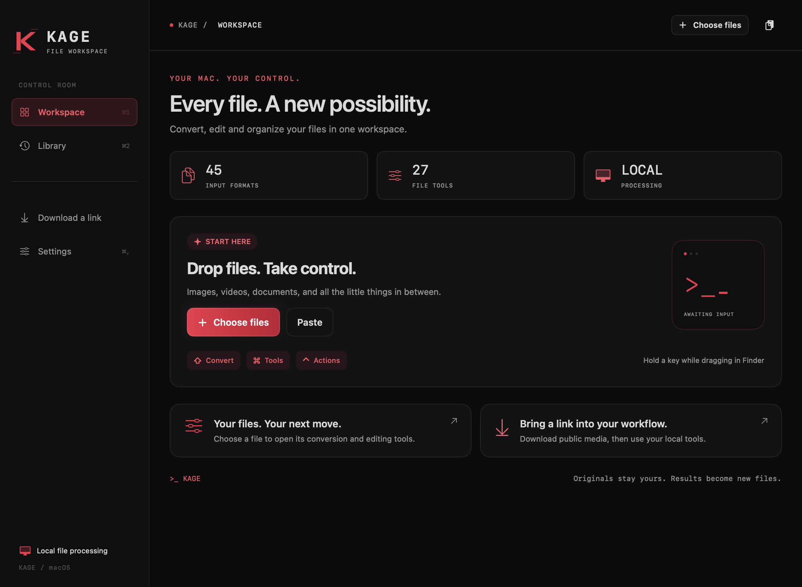

# Kage for macOS

[English](README.md) · [Türkçe](README.tr.md)

**Kage is an independent macOS fork of [Nashi](https://github.com/orkunisitmak/nashi-app), originally created by Orkun Işıtmak and its contributors.** It keeps Nashi’s file conversion and editing tools, adds a black/red terminal-inspired interface, and carries documented bug fixes. Kage-specific changes are by Basri Akkaya. This is not an official Nashi release.



## What it does

- 45 input formats and 27 tools for images, PDFs, audio, video, documents and archives.
- Audio conversion between MP3, M4A, WAV, FLAC, OGG/Vorbis, Opus, AIFF and WMA; trimming, normalization, channel controls and metadata copies.
- File previews, a searchable history, batch exports and the original drag-and-wheel workflow.
- A Kage icon, black/red workspace, and English/Turkish light and dark interfaces. The initial preference is Turkish/dark; change it in Settings.
- Separate application identity and preferences. Nashi’s automatic update channel is disabled for this independently distributed build.

The workspace focuses on conversion and editing. It includes no added file-scanning dashboard, checksum-comparison screen or inspection-report feature. The retained Windows sources are upstream reference code; **Kage releases target Apple Silicon / macOS 13+**.

## Install

1. Download the macOS ZIP from [Kage releases](https://github.com/basriakkaya/nashi-app/releases).
2. Unzip it and drag **Kage.app** into **Applications**.
3. Open Kage and choose or drop a file.

The current build bundles its media, document and metadata tools. Nothing needs to be installed system-wide. This is a **locally/ad-hoc signed build, not an Apple Developer ID notarized release**; macOS may block a downloaded copy. System protections should remain enabled. Automatic updates and launch-at-login are unavailable in this local build. Optional window arrangement is off initially and requires separate macOS permission if enabled.

## Everyday shortcuts

| Shortcut | Action |
| --- | --- |
| ⌘1 / ⌘2 | Workspace / Library |
| ⌘O | Choose files |
| ⌘F | Open Library and focus search |
| ⌘V | Import copied files, text, images or a supported link; paste normally in a text field |
| Enter / ⌘Enter | Open tools for selected files in the workspace |
| Wheel: arrows, Enter, Esc | Choose, apply, cancel |
| Library: ↑/↓, Space, Enter | Select, preview, reuse a result |
| ⌘, / ⌘W / ⌘Q | Settings / close window / quit |
| ⌃⇧D | Open the web-download window; prefill a valid copied HTTP(S) media URL |
| While dragging: ⇧ / ⌘ / ⌃ | Conversion / tools / file actions; configurable in Settings |
| Audio/video editor: Space | Play/pause |
| Editor: ←/→, ⇧←/→ | Seek one second / fine step (a frame for video, 0.1 s for audio) |
| Trim editor: I / O / ⇧Space | Mark in / mark out / play the selected range |
| ⌘S | Save a new output copy |

**Web-link prefill:** copy the actual media/share URL first, then press Control+Shift+D. A local file, checksum or ordinary text is not a web link, so the field is not automatically filled. Public media only; login-required or protected media may be unavailable. Web downloads contact the selected site; conversions and edits run locally.

The native editing tools are available for MP3, M4A, WAV and FLAC. For OGG, Opus, AIFF or WMA, convert to WAV first, then open the resulting file for editing. For audio, choose a source and either an output format or an audio tool. Check the range/channels before saving. Exports create new files, preserving the source; lossy formats can change the signal and file size is not guaranteed to decrease in every conversion.

## Fixes retained from this fork

- Solid image/video redactions remain opaque and cover fractional pixel selections.
- Archive link destinations are validated before files are materialized.
- Document conversions do not write Python caches into signed application resources; CSV/TSV numbers use a consistent locale and PDF slide exports preserve their intended colors.
- ⌘F reliably focuses a newly inserted search field; ⌘W works for borderless tool windows.

These are scoped fixes and test results, not a claim that every possible threat or input is covered. See [validation and audio coverage](docs/testing/KAGE-VALIDATION.md).

## Build from source

Xcode with Swift 6 and Python 3.11+ are required on Apple Silicon macOS.

```sh
python3 scripts/setup-kage-tools.py
zsh scripts/build-kage.sh release
open build/Kage.app
```

The default output is `build/Kage.app`; set `KAGE_APP_OUTPUT` for another destination. Tool downloads are pinned and verified. Bundle contents retain their component licenses.

## Verify

```sh
swift test
python3 scripts/test-native-ui.py --app build/Kage.app/Contents/MacOS/Kage --output work/native-ui
build/Kage.app/Contents/MacOS/Kage --kage-smoke work/packaged-smoke
python3 scripts/test-kage-audio.py --app build/Kage.app --output work/audio-qa
```

Use new, empty output directories. The UI matrix covers 40 scene/theme/language combinations; audio checks generate synthetic signals and verify duration, channels, rate, non-silence, channel identity, round trips and real tool outputs. GitHub runs the full core/update suite, packaged checks and audio validation. Live Instagram/YouTube CDN tests remain opt-in; physical drag/modifier behavior is separate from rendered UI and engine tests.

## Origin and license

Upstream: [orkunisitmak/nashi-app](https://github.com/orkunisitmak/nashi-app). Original copyright and the [MIT license](LICENSE) are preserved. See [Kage notice](Resources/KAGE-NOTICE.txt), [third-party notices](Resources/THIRD-PARTY-NOTICES.txt) and `Resources/licenses/`. Kage is independent of the official Nashi release and Tangerine/LEAP STUDIO. Internal `Nashi*` module names are retained for traceable upstream adaptation.
