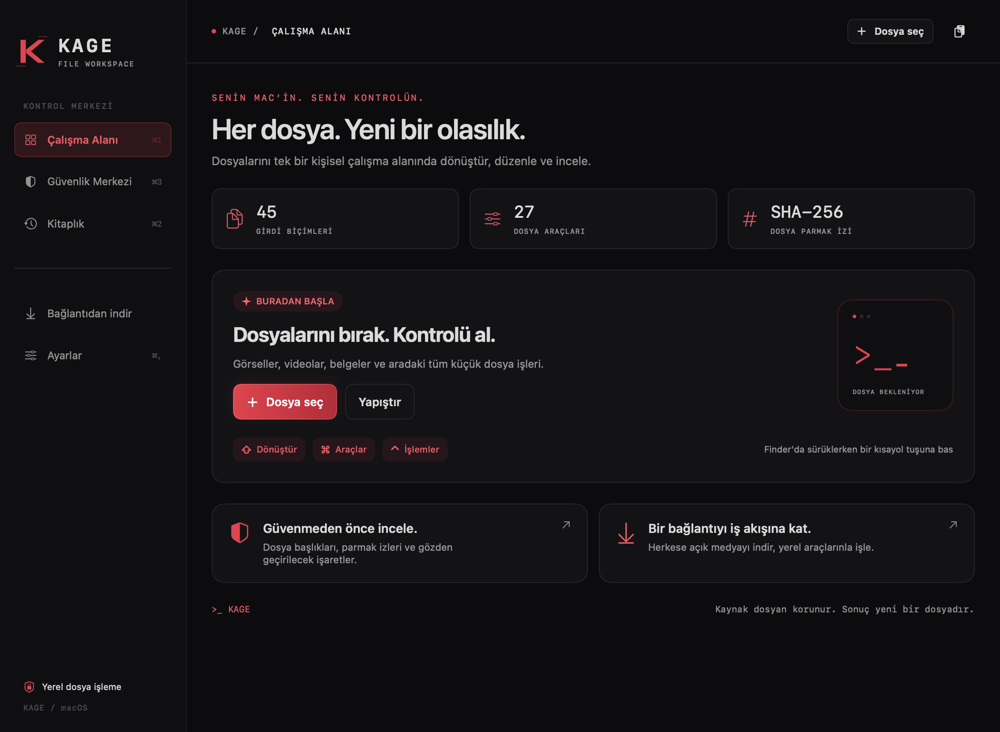

# Kage · macOS

[English](README.md) · [Türkçe](README.tr.md)

Siyah/kırmızı tasarımlı, terminal esintili, yerel güvenlik incelemesi eklenmiş kişisel dosya çalışma alanı. Nashi’nin açık kaynak motoru üzerine bağımsız olarak geliştirilmiştir.



## Özellikler

- Yeni macOS çalışma alanı, işlem geçmişi, sürükle–çark araçları ve dosya önizlemesi.
- 45 girdi biçimi ve 27 dosya aracı: görsel/PDF/medya/belge dönüştürme, kırpma, açıklama, metadata, sansür ve arşiv işlemleri.
- **Güvenlik Merkezi:** SHA-256 parmak izi, beklenen özetle karşılaştırma, dosya başlığı–uzantı farkları, çalıştırılabilir içerik ve izinler, görünmeyen ad karakterleri, karantina gözlemi ve tam dosya yolu içermeyen JSON raporu.
- İnceleme dosyaları yüklemez veya çalıştırmaz. Sembolik bağlantıları, aygıtları ve klasörleri reddeder; iptal edilebilir; dosya işlem sırasında değişirse sonuç verilmez. Antivirüs taraması veya güvenli dosya hükmü değildir.
- Ayrı uygulama kimliği (`com.basriakkaya.kage`), tercihler ve içe aktarılan dosyalar. Nashi’nin güncelleme kanalı ve kayıtlı bağlantıları Kage sürümünde kullanılmaz.
- Türkçe/İngilizce ve açık/koyu tema. İlk açılış tercihi Türkçe ve koyudur.

Nashi’ye ayrı gönderilen sansür ve arşiv sınırı düzeltmeleri Kage’ye dahil edilmiştir. Ürün **Apple Silicon / macOS 13+** içindir. Depodaki Windows kaynakları geçmiş referanstır; Kage Windows sürümü sunulmaz.

## Derle ve kullan

Swift 6 içeren Xcode ve Python 3.11+ gerekir. Yardımcı araçlar sistem geneline kurulmaz, bu çalışma kopyasında hazırlanır.

```sh
python3 scripts/setup-kage-tools.py
zsh scripts/build-kage.sh release
open build/Kage.app
```

Uygulama, doğrulanan medya/Office araçlarını, ExifTool’u, yerel belge kütüphanelerini ve lisanslarını paketler. Varsayılan çıktı `build/Kage.app`; farklı hedef için `KAGE_APP_OUTPUT` kullanılır.

Bu sürüm **yerel ad-hoc imzalıdır**, Apple tarafından notarize edilmiş genel yayın değildir. Kage’ye ait imzalı yayın kanalı kurulana kadar otomatik güncellemeler kapalıdır. İşletim sistemi korumaları kapatılmaz. Bu yerel kopyada oturum açılışında başlatma kullanılamayabilir. Diğer uygulamaların pencerelerini düzenleme özelliği ayrı macOS izni ister ve başlangıçta kapalıdır.

## Akış

Dosya seç veya bırak; ardından dönüşüm ya da araç seç. **⌘1** çalışma alanını, **⌘2** kitaplığı, **⌘3** Güvenlik Merkezi’ni açar. **⌘O** dosya seçer. Güvenlik Merkezi’nin ayrı seçicisi bir işlemde en çok 32 normal dosya alır.

Parmak izini güvenilir bir kaynaktan aldığın değerle karşılaştır. Eşleşme yalnızca sağladığın değerle aynı olduğunu gösterir; yayıncı kimliği veya zararlı yazılım güvenliği garantisi vermez. Metadata ve sansür işlemleri yeni kopya üretir, kaynakları korur.

Komut satırından inceleme:

```sh
build/Kage.app/Contents/MacOS/Kage security /path/to/file
```

## Doğrulama

```sh
swift test
python3 scripts/test-native-ui.py --app build/Kage.app/Contents/MacOS/Kage --output work/native-ui
build/Kage.app/Contents/MacOS/Kage --kage-smoke work/packaged-smoke
```

Arayüz ve paket kontrolleri için yeni, boş çıktı klasörleri seç. Kontroller sentetik dosyalar kullanır. Arayüz denetimi 48 görünüm/tema/dil birleşimini, paket kontrolü içindeki araçlarla gerçek dönüşümleri kapsar; başka macOS sürümleri veya mimariler için kabul kanıtı değildir.

## Kaynak ve lisans

Kage, Basri Akkaya tarafından; Orkun Işıtmak ve katkıda bulunanların [Nashi](https://github.com/orkunisitmak/nashi-app) projesi temel alınarak bağımsız biçimde özelleştirilmiştir. Özgün [MIT lisansı](LICENSE), telif hakkı, atıflar ve üçüncü taraf lisansları korunur. [Kage bildirimi](Resources/KAGE-NOTICE.txt), [üçüncü taraf bildirimleri](Resources/THIRD-PARTY-NOTICES.txt) ve `Resources/licenses/` dizinine bak. Kage resmî Nashi yayını değildir; Tangerine/LEAP STUDIO ile bağlantılı değildir.
